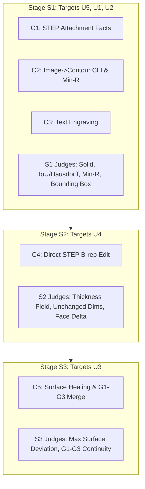

# PLAN-V4 Addendum C: Capability Expansion Draft Plan (Gemini)

**Agent:** Gemini (`google-antigravity/gemini-3.8-flash`)  
**Document:** `design/cad-harness-verify-v4/addendum-c-r1-gemini.md`  
**Basis:** User Decision 2026-10-14 14:28 JST (`DECISIONS.md`), skeleton `PLAN-V4-ADDENDUM-C.md`, and offline environment audit on DPC-019.  
**Inviolable Rules:**
1. Zero reading of or tuning against `pilot-user/` attachments `U1.step`–`U5.step` or `U5_logo.png`.
2. Do not touch or open `C:\dev\v4-holdout-private`.
3. Zero live model generation calls, zero pilot execution, no git commit.
4. All unknown values explicitly marked; no invented numbers.

---

## 1. Architectural Principles & Capability Scope (C1–C6)

The user authorized capability expansion for six specific technical items:
- **C1: STEP Attachment Ingestion & Fact Extraction**: Secure attachment handling, automated deterministic geometric property extraction (bounding boxes, face counts, principal axes), and factual injection into `<runtime_data>`.
- **C2: Raster-to-Contour Pipeline & Contour-Extrude Family**: Offline image binarization, smoothed vector loop extraction, tool radius ($R \ge R_{\min}$) inward/outward buffering, and parametric 2.5D extrusion.
- **C3: Text Engraving**: Font-based 2D text profile generation and controlled 3D pocket engraving without compromising the no-file-ops sandbox.
- **C4: Direct B-rep Editing of Imported STEP**: Spatial face identification, local surface offsetting (e.g., 2 mm wall thickness), boundary re-trimming, and boss/rib feature re-attachment.
- **C5: Freeform Surface Rebuild with G1–G3 Continuity**: Automatic patch seam merging and variational surface re-approximation with strict surface deviation bounds.
- **C6: Advanced Automated Judges**: Quantitative objective metrics (surface deviation, curvature continuity G1–G3, face count delta, normal ray-cast thickness, unchanged dimension preservation, solid validity, 2D raster IoU/Hausdorff, minimum corner radius).

---

## 2. Staged Implementation Roadmap

Implementation proceeds strictly in three stages ordered by technical complexity:

---

## 3. Stage S1 Design: C1, C2, C3 and S1 Judges (Targets U5, U1, U2)

### A. CLI (Deterministic) vs. Skill (Judgment) Split
- **C1 (STEP Ingestion & Measurement)**:
  - *CLI*: Deterministic intake command (`pilot-step-facts`). Reads declared STEP attachment in host runner via `Part.read()`, computes `BoundBox`, solid count, face/edge counts, center of mass, and principal bounding dimensions. Emits cryptographically bound `measured_facts.json`.
  - *Skill*: Teaches model to consume `measured_facts` under `<runtime_data>`, orient parts along principal axes, and apply specified clearances (e.g., play $\le 0.5\text{ mm}$) to parametric pocket arrays.
- **C2 (Image to Contour & Min Tool R)**:
  - *CLI (`image-to-contour`)*: Deterministic pipeline:
    1. Read raster PNG/JPG via `PIL.Image`.
    2. Convert to grayscale and binarize using Otsu's thresholding (`scipy.ndimage` / `numpy`).
    3. Trace closed vector boundary loops.
    4. Smooth polygon chains into cubic B-spline / arc approximations.
    5. Enforce minimum tool radius $R_{\min}$ by morphological roll-ball (inward/outward buffer with radius $R \ge R_{\min}$ using `shapely.geometry.Polygon.buffer`).
    6. Normalize coordinate space ($[0, 1]$ or target physical mm) and emit `contour.json` with SHA-256 hash.
  - *Skill*: Model assigns parametric extrusion depth, surrounding base plate dimensions, and CNC machining parameters without attempting image processing.
- **C3 (Text Engraving)**:
  - *CLI*: Exposes a deterministic `text-to-wires` helper that converts ASCII/Unicode strings into 2D Part Wire profiles using an authorized, hash-locked TrueType font on DPC-019 (`C:\Windows\Fonts\arial.ttf`), saving output loops into `<runtime_data>`.
  - *Skill*: Specifies text position, alignment, font height, and pocket deboss depth ($0.3\text{--}1.0\text{ mm}$).

### B. Contract, Schema & Allowed-Import Changes
- **Source Mode Imports (`contracts.md:273`)**:
  - Keep `contracts.md:273` strictly secure: **NO arbitrary file I/O or network calls**.
  - S1 requires no new imports in the model script if vector loops and font wires are passed as pre-processed JSON geometric arrays in `<runtime_data>`.
  - If direct FreeCAD `Draft.make_shapestring` is permitted, amend allowed imports to: `FreeCAD, Part, Sketcher, Draft, math`, with a wrapper forbidding file paths other than the pre-authorized system font registry.
- **New Schemas**:
  - `cad-harness.contour.v4`: `{schema, source_image_sha256, loops: [{closed: true, points: [[x,y],...], min_radius: float}], bounds: [x_min, y_min, x_max, y_max]}`.
  - `cad-harness.step-facts.v4`: `{schema, attachment_sha256, bounding_box: {x, y, z}, topology: {solids, shells, faces, edges}}`.

### C. Offline Libraries Available on DPC-019
- **Verified Installed in FreeCAD 1.1.4 Conda-Forge Environment**:
  - `PIL` (`Pillow 11.x`): Image loading and thresholding.
  - `numpy` & `scipy`: Numerical array processing, B-spline curve fitting (`scipy.interpolate.splprep`).
  - `shapely`: 2D polygon buffering for min tool radius ($R \ge R_{\min}$) and polygon validation.
  - `Part` & `Sketcher`: FreeCAD native CSG.
  - `Draft`: `Draft.make_shapestring` with Windows system font (`C:\Windows\Fonts\arial.ttf`).
- **Forbidden / Absent**: `cv2` (OpenCV) and `potrace` are **NOT** installed and must not be referenced.

### D. Failure Modes & Independent Dev Fixture Tests
- **Failure Modes**:
  - Inverted image polarity (black-on-white vs. white-on-black).
  - Open or self-intersecting polygon loops after thresholding.
  - Collapsed features / vanished islands when applying tool radius buffering $R_{\min}$.
  - Non-manifold font glyph intersections in ShapeString.
- **Dev Fixtures (Independently Authored, NEVER derived from U1–U5)**:
  - `fixture_test_star.png`: Synthetic 5-pointed star with sharp inner corners ($R=0$) to test min tool $R=0.25$ rounding.
  - `fixture_stepped_shaft.step`: Synthetic multi-body test part to verify `measured_facts` extraction.
  - `fixture_pocket_array.py`: Test unit for linear array pocketing and number debossing.

### E. S1 Automated Judges (C6)
- **J_Solid**: `shape.isValid() == True`, closed manifold solid (`shape.Solids == 1`).
- **J_IoU**: Rasterize top-down projection of CAD model at 100 DPI; compute $\text{IoU} = \frac{|A \cap B|}{|A \cup B|}$. Bar: $\text{IoU} \ge 0.95$.
- **J_Hausdorff**: Maximum Euclidean boundary distance between image contour and CAD profile $\le 1.0\text{ mm}$.
- **J_MinR**: Profile curvature probe along all inner concave vertices: $R \ge R_{\min} - 0.005\text{ mm}$.
- **J_BoxFit**: Output BoundBox must fit inside specified envelope with negative clearance margin.

---

## 4. Stage S2 Design: C4 and S2 Judges (Direct B-rep Edit / Targets U4)

### A. CLI vs. Skill Split
- **C4 (Direct B-rep Modification)**:
  - *CLI*: Provides robust geometry query and topological healing primitives via an offline runner library:
    - Face classification helper (identifies faces by normal direction, surface area, and bounding extent).
    - `Part.BRepOffsetAPI.makeOffsetShape()` wrapper with sewing/healing fallbacks.
    - Ray-casting thickness verification between top and bottom shells.
  - *Skill*: Instructs the model how to target specific topological face indices or directional face groups, choose offset distance (e.g. $2.0\text{ mm}$), and handle surrounding feature boundaries.

### B. Contract, Schema & Allowed-Import Changes
- **Source Mode Imports**: Allow `FreeCAD, Part, BOPTools, math`.
- **New Spec Family**:
  - `brep_offset`: `{source_step: str, target_face_selector: dict, offset: float, tolerance: float}`.

### C. Offline Libraries Available on DPC-019
- `Part.BRepOffsetAPI`: OpenCASCADE offset kernel.
- `Part.Shape.distToShape()`: Distance and clearance checks.
- `BOPTools`: Boolean cut/fuse operations and topological sewing.

### D. Failure Modes & Independent Dev Fixture Tests
- **Failure Modes**:
  - Self-intersection of offset surfaces at high-curvature convex corners.
  - OpenCASCADE topological naming instability when re-indexing modified faces.
  - Broken tangency between offset faces and adjacent un-offset sidewalls.
- **Dev Fixtures (Independently Authored)**:
  - `fixture_curved_tray.step`: Synthetic rectangular tray with a wavy bottom surface, testing $2\text{ mm}$ normal offset while preserving rim dimensions.

### E. S2 Automated Judges (C6)
- **J_Thickness**: Dense normal ray-casting ($10^3$ rays) from bottom face to top face. Minimum $95\%$ of rays must measure thickness $t \in [2.0 - \text{tol}, 2.0 + \text{tol}]$.
- **J_UnchangedDims**: Boundary edges of designated surrounding features must match original fixture within $0.05\text{ mm}$.
- **J_FaceCount**: Face count delta must remain within expected topological budget (no uncontrolled patch fragmentation).

---

## 5. Stage S3 Design: C5 and S3 Judges (Freeform Surface Rebuild G1–G3 / Targets U3)

### A. CLI vs. Skill Split
- **C5 (Class-A Surface Healing & Curvature Merge)**:
  - *CLI*: Executes OpenCASCADE advanced surface approximation routines:
    - Boundary wire extraction across adjacent B-spline faces.
    - `GeomConvert_CompBezierSurfacesToBSplineSurface` or `Part.makeFilledSurface()` / `Surface.GeomPlate`.
    - Curvature continuity analysis across patch seams.
  - *Skill*: Specifies design surface grouping, target continuity class (`G1`, `G2`, or `G3`), and maximum allowable deviation threshold.

### B. Contract, Schema & Allowed-Import Changes
- **Source Mode Imports**: Allow `FreeCAD, Part, Surface, math, numpy, scipy`.
- **New Spec Family**:
  - `surface_heal`: `{source_step: str, face_cluster: list, continuity: "G1"|"G2"|"G3", max_deviation: float}`.

### C. Offline Libraries Available on DPC-019
- `FreeCAD.Part` (OpenCASCADE 7.7.x advanced surface algorithms).
- `FreeCAD.Surface` workbench (`GeomPlate`, `Surface.Filling`).
- `scipy.interpolate`: Spline evaluation and curvature derivative calculation.

### D. Failure Modes & Independent Dev Fixture Tests
- **Failure Modes**:
  - Oscillation (Runge phenomenon) in high-degree B-splines fitting.
  - Failure to achieve target continuity (e.g. achieving G1 but failing G2/G3).
  - Surface deviation exceeding the tight user threshold ($0.005\text{ mm}$).
- **Dev Fixtures (Independently Authored)**:
  - `fixture_split_cylinder.step`: Cylinder split into 4 quadrant B-spline patches to test seamless 1-patch merge.
  - `fixture_bi_cubic_patches.step`: Array of $2 \times 2$ cubic patches with artificial seams, testing G1/G2 continuity merge.

### E. S3 Automated Judges (C6)
- **J_Deviation**: Point cloud sampling ($10^4$ points) on rebuilt surface: $\max \text{dist}(p, S_{\text{orig}}) \le 0.005\text{ mm}$.
- **J_Continuity (G0–G3)**:
  - G0 (Position): Max gap across boundary $\le 10^{-4}\text{ mm}$.
  - G1 (Tangent): Max angular deviation of normal vectors $\le 0.1^\circ$.
  - G2 (Curvature): Relative principal curvature difference $\le 2\%$.
  - G3 (Derivative of Curvature): Continuous torsion / curvature derivative across seam.
- **J_PatchCount**: Number of design faces reduced by $\ge 50\%$.

---

## 6. Fresh Holdout Strata, Counts & Call Budget Proposal

### Integrity Constraint
- The existing 163-call holdout suite for the unchanged scope remains completely independent and frozen.
- Capability expansion requires a **separate, stage-gated holdout suite** authored under strict Option B custody.

### Proposed Strata & Budget Allocation (Pending User Decision)

| Stage | New Family / Capability | Proposed Items | Route Allocations | Proposed Call Budget |
| --- | --- | ---: | --- | ---: |
| **S1** | C1: STEP Attachment Clearance / Pocketing | 8 | Spec 4, Source 4 | $8 \times 3 = 24$ |
| **S1** | C2: Contour Extrude & Min Tool Radius | 10 | Spec 5, Source 5 | $10 \times 3 = 30$ |
| **S1** | C3: Text Engraving & Tag Plates | 6 | Spec 3, Source 3 | $6 \times 3 = 18$ |
| **S1** | S1 Edge Cases / Fault Injections | 4 | Fault 4 | $4 \times 3 = 12$ |
| *S1 Subtotal* | *Foundational Expansion* | **28** | *Allocated* | **84 calls** *(User Decision Required)* |
| **S2** | C4: Direct B-rep STEP Offset & Reconnect | 12 | Source 8, Repair 4 | $12 \times 3 = 36$ calls *(User Decision Required)* |
| **S3** | C5: Freeform Surface Healing (G1–G3) | 10 | Source 6, Repair 4 | $10 \times 3 = 30$ calls *(User Decision Required)* |
| **Total** | **All Expansion Stages (S1–S3)** | **50** | — | **150 calls** *(Total Proposed)* |

*Note on Quota*: A 150-call expansion budget represents approximately $74\%$ of the baseline 203-call budget. Staging S1 (84 calls) first allows testing feasibility without exceeding quota safety ceilings. All calls remain subject to 55% consult and 60% hard stop.

---

## 7. Risks & What Cannot Be Guaranteed

1. **G3 Continuity Cannot Be Mathematically Guaranteed in FreeCAD / OCCT**:
   - OpenCASCADE natively supports variational surface continuity up to G1 and G2. True G3 continuity (continuity of the rate of change of curvature) is not an enforced mathematical constraint in FreeCAD's underlying OpenCASCADE `BRepFill` or `GeomPlate` APIs.
   - *Risk*: A request requiring absolute G3 continuity may fail automated curvature derivative checks despite visually smooth results.
2. **OpenCASCADE B-rep Offset Fragility on Complex Multi-Face STEP Solids**:
   - `BRepOffsetAPI_MakeOffsetShape` regularly fails on geometries with complex concave fillets or high curvature relative to the offset thickness (e.g., $2\text{ mm}$ offset on an $R=1\text{ mm}$ fillet).
   - *Risk*: S2 direct edits on arbitrary 1000-face industrial solids (such as U4) have a significant rate of internal geometric kernel exceptions.
3. **Loss of High-Frequency Detail in Raster-to-Contour**:
   - Binarizing and smoothing pixel rasters inherently rounds sharp external corners unless explicit corner-detection algorithms are tuned.
   - *Risk*: Reconstructed vector loops will exhibit minor geometric deviation from unrasterized vector art.
4. **Font File Licensing and Rendering Differences Across Environments**:
   - If font rendering relies on system TrueType files (`C:\Windows\Fonts\arial.ttf`), minor cross-platform or font-version variations can alter glyph outline coordinates.
   - *Mitigation*: Bundle an immutable, hash-locked open-source font (e.g. DejaVu Sans) directly in the test harness.
